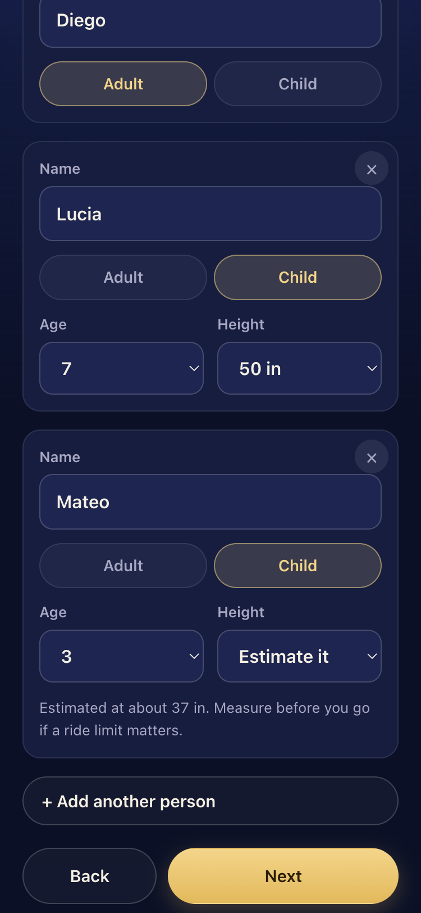
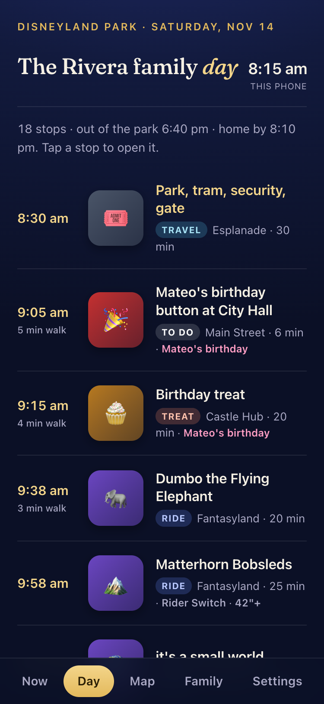
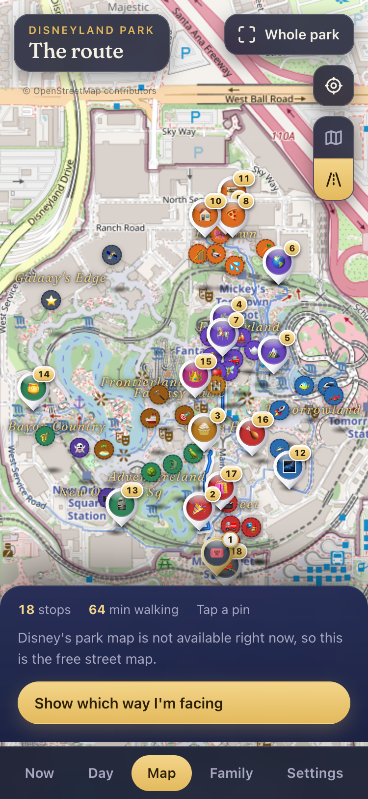

# Disney Day Planner

A phone-sized web app that plans one day at the Disneyland Resort around your family.

It covers both parks in Anaheim, California: Disneyland Park and Disney California Adventure Park. Plan a day in one park, or a Park Hopper day that starts in one and moves to the other. It doesn't cover Walt Disney World, Disneyland Paris or the other Disney parks yet.

You answer five short questions. It builds a minute-by-minute plan with walking times, nap breaks, meals, height limits, a rider switch for kids who are too short, and a map of the route. During the day it re-plans when you run late, skip a ride, or swap one for another.

Fan-made, not affiliated with Disney. Disney, Disneyland and the ride and character names are trademarks of their owners and are used here only to describe the park.





The people in the screenshots are a made-up family.

## What you get

- A setup flow on first open: park, park hopping and date, who is coming (names, kids' ages and heights), nap or break time, must-do rides, and any special occasion.
- A plan built from those answers. A birthday adds a celebration button stop and a treat stop.
- Park hopping: turn it on in setup and the plan walks you across the Esplanade to the other park, at a time you pick or one the planner picks to split the day fairly. Rides you add later go into the part of the day spent in their own park.
- Five tabs: **Now** (what to do next), **Day** (the whole plan), **Map** (the route and walking time), **Family** (who can ride what), and **Settings**.
- Everything stays on your phone. There is no account and no server.
- Optional: share the plan and live locations with the rest of your group (see below). This is off until you set it up.

## Try it on your computer

You need Python, which comes with a Mac.

```
python3 -m http.server 8000
```

Open http://localhost:8000 in your browser. On a computer, make the window narrow to see the phone layout.

## Let Claude Code set it up for you

Open this folder in Claude Code and say:

> set up my day

`CLAUDE.md` tells Claude how this project works. It will ask for your park date, who is coming, nap times and must-do rides, write them into the setup, check the plan for problems like a ride that nobody in your group is tall enough for, and offer to put it online.

You can also ask it to change things later, for example "move lunch to 12:30" or "add the Jungle Cruise as a must-do".

## Put it online (about five minutes)

Hosting is free on Vercel. Your phone needs a web address to open it.

1. Make a free account at vercel.com.
2. Install the Vercel command line tool: `npm install -g vercel`.
3. In this folder, run `vercel`. Accept the defaults. When it asks about a build command or output folder, leave them blank. This project has no build step.
4. Run `vercel --prod`. It prints your address. Open it on your phone.
5. On an iPhone, tap Share, then Add to Home Screen. On Android, use the browser menu, then Add to Home screen.

Each phone keeps its own copy of the plan unless you turn on sharing.

## Share with the group (optional)

This lets everyone in your group see the same plan, mark rides done, and see each other on the map. It uses your own free Supabase project, so nobody else can see your data and nothing goes through anyone else's server.

1. Make a free project at supabase.com.
2. In the project, open **SQL Editor**, paste the contents of `schema.sql`, and run it.
3. Open **Project Settings, then API**. Copy the project URL and the **publishable** key. The publishable key is meant to be public. Never use a secret or service key.
4. In the app, open **Settings** and paste both into the sharing box, then tap **Turn on sharing**.
5. Tap **Copy invite link** and text it to your group. Opening the link loads your plan on their phone. They pick which person they are, and can then share their location.

You can also put the URL and key in `config.js` so every copy of the app starts with sharing ready.

Be aware of how this is protected. Each group gets a long random code, and the app sends that code with every request. The database only answers a request that carries the matching code, so the key alone cannot list other groups' plans. Anyone who has your invite link can read and edit your plan and see your group's locations. Do not post the link publicly. Delete the project when the trip is over.

If you turned on sharing before this protection existed, open the SQL Editor and run the current `schema.sql` once more. It replaces the old open rules.

## Live wait times

On the day of your visit, the app shows how long each line is right now. Each ride gets a small tag such as "35 min wait", "Down right now" or "Closed today", and Lightning Lane rides show the next return time. A ride that is down or closed also gets a note suggesting Later or Skip. Nothing is skipped for you.

The planner uses the live standby wait, instead of its usual guess, for rides that start in the next two hours and are not on Lightning Lane. So the plan shifts when a line is long or short. Anything without a live wait keeps the usual plan.

The numbers come from [ThemeParks.wiki](https://themeparks.wiki), a free service, and the app credits it in Settings and under the plan. The app asks for them at most every two minutes, only while the page is open on screen, and only on the date you set for the visit. Before that day, or if the service cannot be reached, you see nothing and the plan is unchanged. Waits older than 15 minutes are ignored. Turn this off any time in **Settings, then Live wait times**.

Disney does not provide these numbers, so they can be wrong or late. Check the official Disneyland app before you commit to a line.

## Maps and rights

- The **Park** map is Disney's own illustrated map. The app loads it from Disney's servers while you browse. Nothing from Disney is stored in this project. It is unofficial, so Disney could change or block it at any time. If the tiles stop loading, the app switches to the free street map by itself.
- The **Street** map is OpenStreetMap, which is free and open. The walking routes also come from OpenStreetMap data. © OpenStreetMap contributors, ODbL.
- If you want no Disney requests at all, set `disneyMapTiles: false` in `config.js`.
- There are no Disney photos or logos in this project. The pictures in the app are emoji and drawn shapes.

Ride height limits and Lightning Lane Multi Pass rides in `catalog.js` were checked on disneyland.com (Disneyland Park in October 2026, California Adventure on November 5, 2026). They change, so check the official Disneyland app before you go.

## Where things live

| File | What it does |
|---|---|
| `index.html`, `styles.css` | The page and its look |
| `setup.js` | The five setup questions |
| `catalog.js` | Both parks' rides, shows, food stops and walking times |
| `planner.js` | Turns your answers plus the catalog into a plan |
| `waits.js` | Fetches live ride waits on the day of the visit (ThemeParks.wiki) |
| `app.js` | The schedule engine, the tabs, the map and group sharing |
| `intro.js` | The opening animation |
| `main.js` | Decides whether to show setup or the plan |
| `config.js` | Optional settings |
| `paths.js` | Walkway data from OpenStreetMap |
| `schema.sql` | The two tables for group sharing, and the table that collects feedback notes |

## Feedback

**Settings, then Send feedback** sends a short note to the person who made the planner. It includes the screen you were on, the app version and your browser type. It never includes names, your answers or your location. An email address is optional and only used to reply. The notes are read weekly. To hide the button in your own copy, set `feedback.url` to `""` in `config.js`.

## Start over

In the app, open **Settings** and tap **Redo setup**. Or add `?setup` to the address.

## License

MIT, see `LICENSE`. Walkway data in `paths.js` is © OpenStreetMap contributors, ODbL.
